  

  
  
  
  

  
  
  
  

---

## 👋 Sobre mim

🎓 Estudante de **Sistemas de Informação** na **UNEX** — em andamento (1º semestre).

💼 Estágio de Desenvolvimento na **Vittal Web**, no setor de **Inteligência Artificial, Sistemas e Automação**.

💻 Desenvolvedor **Full Stack** com experiência prática em aplicações web, APIs REST e integração de **agentes de Inteligência Artificial** para automatizar processos e eliminar tarefas manuais.

📚 Busco constantemente evoluir minhas habilidades: boas práticas, organização de código e aplicações bem estruturadas.

🚀 Em busca de **oportunidades como desenvolvedor Full Stack / IA**.

  

  

---

## 💼 Experiência

<table align="center">
<tr>
<td width="50%" valign="top">

#### 🏢 Vittal Web

`Jun/2026 – Nov/2026` • **Estagiário de Desenvolvimento**

<i>Setor de Inteligência Artificial, Sistemas e Automação</i>

- Softwares **Full Stack** com Node.js, Express e React — da interface à API e produção
- **Agentes de IA** e automações para otimizar processos internos e eliminar tarefas manuais
- Levantamento de requisitos, modelagem de dados e integração com serviços externos
- Correção de bugs, testes, Git/GitHub e acompanhamento das demandas

</td>
<td width="50%" valign="top">

#### 🏢 Vittal Web

`Jun/2026 – Jul/2026` • **Desenvolvedor Freelancer**

- Entrega de projeto web **Full Stack** com Node.js, Express e React em **um mês**
- Ciclo completo: planejamento → desenvolvimento → deploy
- Atuação no ciclo completo antes da efetivação no programa de estágio

 

#### 🎓 Formação

- **Sistemas de Informação** — Bacharelado, **UNEX**
- Em andamento • 1º semestre

</td>
</tr>
</table>

---

## 📂 Projetos

<table align="center">
<tr>
<td width="50%" valign="top">

#### 🔹 [Gnosis IA](https://github.com/Tyago-santos/ia_study)

Plataforma de estudos com Inteligência Artificial — gera materiais a partir do conteúdo do usuário.

<code>Node.js</code> <code>PostgreSQL</code> <code>React</code> <code>React Native</code>

</td>
<td width="50%" valign="top">

#### 🔹 [Polearn](https://github.com/Tyago-santos/polearn)

Plataforma de aprendizado de idiomas com questões geradas por Inteligência Artificial.

<code>React</code> <code>TypeScript</code> <code>Firebase</code>

</td>
</tr>
<tr>
<td width="50%" valign="top">

#### 🔹 [Connect Dev](https://github.com/Tyago-santos/connect-dev)

Rede social para desenvolvedores com posts, curtidas, comentários e sistema de seguidores.

<code>Node.js</code> <code>Express</code> <code>TypeScript</code>

</td>
<td width="50%" valign="top">

#### 🔹 [Promise](https://github.com/Tyago-santos/promise)

Rede social para conexão e novas amizades dentro da comunidade cristã.

<code>React</code> <code>Node.js</code> <code>PostgreSQL</code> <code>Supabase</code>

</td>
</tr>
</table>

  

---

## 🚀 Tecnologias

<table align="center">
<tr>
<td width="34%" align="center" valign="top">

**🎨 Front-end**

</td>
<td width="33%" align="center" valign="top">

**⚙️ Back-end & Dados**

</td>
<td width="33%" align="center" valign="top">

**🤖 IA & Infra**

</td>
</tr>
</table>

---

## 📊 Estatísticas

  

  

  

  

<b>🐍 Contribution Snake</b>

 

  

---

  ⭐ <b>Obrigado por visitar meu perfil</b> ⭐ 
  Feito com 💚 por Tiago Santos

